<!--
  Hackpuntes Dark profile.
  Every NAME:START / NAME:END marker block and everything in assets/dist/ is
  generated from assets/profile.toml by assets/build.py: edit the TOML, not
  the output. POSTS is refreshed daily by the "Latest blog posts" workflow.
  The README always ends with the FOOTER block (Made with ❤️ in Spain).
-->


<!-- NAV:START -->

<a href="https://www.exploit-db.com/?author=9580">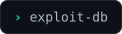</a>

<a href="https://x.com/jjavierolmedo">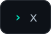</a>

<!-- NAV:END -->

<picture>
  <source media="(prefers-color-scheme: light)" srcset="assets/dist/title-whoami-light.svg">
  
</picture>

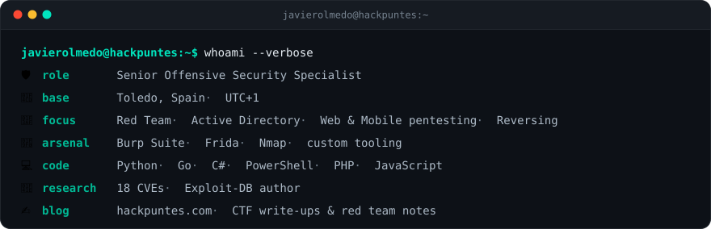

<picture>
  <source media="(prefers-color-scheme: light)" srcset="assets/dist/title-certs-light.svg">
  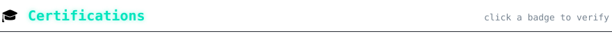
</picture>

<!-- CERTS:START -->

<a title="CRTO" href="https://certs.zeropointsecurity.co.uk/a4cbfb9a-a7d9-44a0-832a-9ea6e805d58a">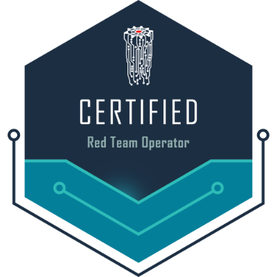</a>

<a title="CRTL · in progress" href="https://www.zeropointsecurity.co.uk/course/red-team-ops-ii">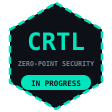</a>
<a title="CAPE · in progress" href="https://academy.hackthebox.com/preview/certifications/htb-certified-active-directory-pentesting-expert">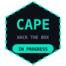</a>

<!-- CERTS:END -->

<!-- BADGES (oculto)
## 🏅 Badges

-->

<picture>
  <source media="(prefers-color-scheme: light)" srcset="assets/dist/title-projects-light.svg">
  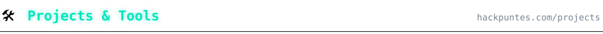
</picture>

<!-- PROJECTS:START -->

<a href="https://hackpuntes.com/projects/obsidian-hackpuntes-theme/">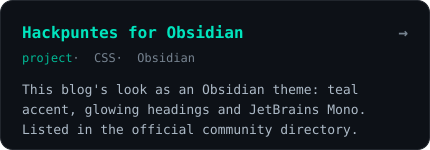</a>
<a href="https://hackpuntes.com/tools/redteam-command-generator/">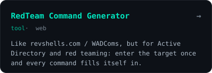</a>
<a href="https://hackpuntes.com/projects/ipdiscover/">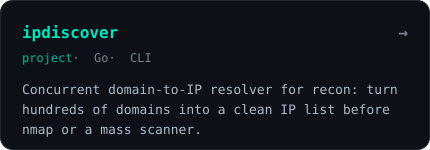</a>
<a href="https://hackpuntes.com/projects/ultimate-cms-wordlists/">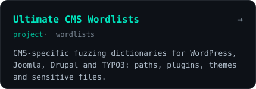</a>
<a href="https://hackpuntes.com/tools/cvss-calculator/">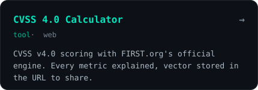</a>
<a href="https://hackpuntes.com/tools/owasp-risk-calculator/">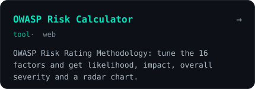</a>

<!-- PROJECTS:END -->

<picture>
  <source media="(prefers-color-scheme: light)" srcset="assets/dist/title-cves-light.svg">
  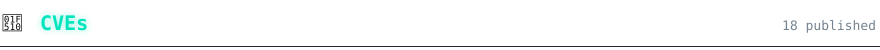
</picture>

<!-- CVE-CARD:START -->
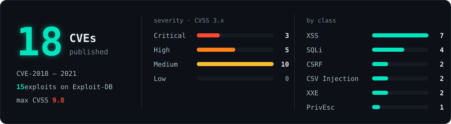
<!-- CVE-CARD:END -->

<b>📋 Show the full CVE list</b>

 

<!-- CVE-TABLE:START -->
| CVE | Vulnerability | CVSS 3.x | Exploit-DB |
|:--|:--|:--|:--:|
| [CVE-2018-13832](https://www.cve.org/CVERecord?id=CVE-2018-13832) | All In One Favicon ≤ 4.6 — [Multiple Stored Authenticated XSS](https://hackpuntes.com/es/posts/cve-2018-13832-wp-plugin-all-in-one-favicon-4-6-autenticado-multiples-xss/) | 🟨 `4.8` Medium | [45056](https://www.exploit-db.com/exploits/45056) |
| [CVE-2018-14430](https://www.cve.org/CVERecord?id=CVE-2018-14430) | Multi Step Form ≤ 1.2.5 — [Multiple Unauthenticated Reflected XSS](https://hackpuntes.com/es/posts/cve-2018-14430-wordpress-plugin-multi-step-form-125-multiples-xss-reflejados/) | 🟨 `6.1` Medium | — |
| [CVE-2018-15571](https://www.cve.org/CVERecord?id=CVE-2018-15571) | Export Users to CSV ≤ 1.1.1 — [CSV Injection](https://hackpuntes.com/es/posts/cve-2018-15571-wordpress-plugin-export-users-to-csv-1-1-1-csv-injection/) | 🟧 `8.6` High | [45206](https://www.exploit-db.com/exploits/45206) |
| [CVE-2018-15873](https://www.cve.org/CVERecord?id=CVE-2018-15873) | Sentrifugo HRMS 3.2 — [Blind SQL Injection](https://hackpuntes.com/es/posts/cve-2018-15873-sentrifugo-hrms-3-2-blind-sql-injection/) | 🟥 `9.8` Critical | [45266](https://www.exploit-db.com/exploits/45266) |
| [CVE-2018-15917](https://www.cve.org/CVERecord?id=CVE-2018-15917) | Jorani Leave Management 0.6.5 — [Stored XSS](https://hackpuntes.com/es/posts/cve-2018-15917-jorani-leave-management-system-0-6-5-cross-site-scripting-persistente/) | 🟨 `5.4` Medium | [45338](https://www.exploit-db.com/exploits/45338) |
| [CVE-2018-15918](https://www.cve.org/CVERecord?id=CVE-2018-15918) | Jorani Leave Management 0.6.5 — [SQL Injection](https://hackpuntes.com/es/posts/cve-2018-15918-jorani-leave-management-system-0-6-5-sql-injection/) | 🟨 `5.4` Medium | [45340](https://www.exploit-db.com/exploits/45340) |
| [CVE-2018-18478](https://www.cve.org/CVERecord?id=CVE-2018-18478) | LibreNMS 1.43 — [Stored XSS](https://hackpuntes.com/es/posts/cve-2018-18478-libre-nms-1-43-cross-site-scripting-persistente/) | 🟨 `6.1` Medium | — |
| [CVE-2018-18921](https://www.cve.org/CVERecord?id=CVE-2018-18921) | PHP Server Monitor 3.3.1 — [CSRF](https://hackpuntes.com/es/posts/cve-2018-18921-php-server-monitor-3-3-1-cross-site-request-forgery/) | 🟨 `6.5` Medium | [45932](https://www.exploit-db.com/exploits/45932) |
| [CVE-2018-18922](https://www.cve.org/CVERecord?id=CVE-2018-18922) | Ticketly 1.0 — [Privilege Escalation](https://hackpuntes.com/es/posts/cve-2018-18922-ticketly-escalacion-de-privilegios-crear-cuenta-administrador/) | 🟥 `9.8` Critical | [45892](https://www.exploit-db.com/exploits/45892) |
| [CVE-2018-18923](https://www.cve.org/CVERecord?id=CVE-2018-18923) | Ticketly 1.0 — [Multiple SQL Injection](https://hackpuntes.com/es/posts/cve-2018-18923-ticketly-multiples-sql-injections/) | 🟥 `9.8` Critical | [45902](https://www.exploit-db.com/exploits/45902) |
| [CVE-2018-19828](https://www.cve.org/CVERecord?id=CVE-2018-19828) | Integria IMS 5.0.83 — [Reflected XSS](https://hackpuntes.com/es/posts/cve-2018-19828-integria-ims-5-0-83-cross-site-scripting-reflejado/) | 🟨 `6.1` Medium | [46012](https://www.exploit-db.com/exploits/46012) |
| [CVE-2018-19829](https://www.cve.org/CVERecord?id=CVE-2018-19829) | Integria IMS 5.0.83 — [CSRF](https://hackpuntes.com/es/posts/cve-2018-19829-integria-ims-5-0-83-cross-site-request-forgery/) | 🟨 `6.5` Medium | [46013](https://www.exploit-db.com/exploits/46013) |
| [CVE-2019-7400](https://www.cve.org/CVERecord?id=CVE-2019-7400) | Rukovoditel ERP & CRM < 2.4.1 — [Reflected XSS](https://hackpuntes.com/es/posts/cve-2019-7400-rukovoditel-erp-crm-2-4-1-cross-site-scripting-reflejado/) | 🟨 `6.1` Medium | [46608](https://www.exploit-db.com/exploits/46608) |
| [CVE-2019-15092](https://www.cve.org/CVERecord?id=CVE-2019-15092) | Import Export WordPress Users 1.3.0 — [CSV Injection](https://hackpuntes.com/es/posts/cve-2019-15092-wordpress-plugin-import-export-users-1-3-0-csv-injection/) | 🟧 `7.3` High | [47303](https://www.exploit-db.com/exploits/47303) |
| [CVE-2019-19031](https://www.cve.org/CVERecord?id=CVE-2019-19031) | Easy XML Editor ≤ 1.7.8 — [XXE Injection](https://hackpuntes.com/es/posts/cve-2019-19031-easy-xml-editor-1-7-8-inyeccion-xml/) | 🟧 `8.1` High | [47945](https://www.exploit-db.com/exploits/47945) |
| [CVE-2019-19032](https://www.cve.org/CVERecord?id=CVE-2019-19032) | XMLBlueprint ≤ 16.191112 — [XXE Injection](https://hackpuntes.com/es/posts/cve-2019-19032-xmlblueprint-16-191112-inyeccion-xml/) | 🟧 `8.1` High | [47974](https://www.exploit-db.com/exploits/47974) |
| [CVE-2020-9038](https://www.cve.org/CVERecord?id=CVE-2020-9038) | Joplin ≤ 1.0.184 — [Arbitrary File Read via XSS](https://github.com/laurent22/joplin/commit/3db47b575b9cb0a765da3d283baa2c065df0d0bc) | 🟨 `5.4` Medium | [48147](https://www.exploit-db.com/exploits/48147) |
| [CVE-2021-43091](https://www.cve.org/CVERecord?id=CVE-2021-43091) | YesWiki — [SQL Injection](https://huntr.com/bounties/07f245a7-ee9f-4b55-a0cc-13d5cb1be6e0) | 🟧 `7.5` High | — |
<!-- CVE-TABLE:END -->

<picture>
  <source media="(prefers-color-scheme: light)" srcset="assets/dist/title-posts-light.svg">
  
</picture>

<!-- POSTS:START -->

<a href="https://hackpuntes.com/posts/hackthebox/challenges/dark-embargo/">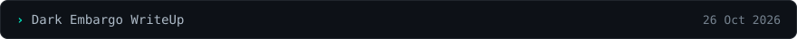</a>
<a href="https://hackpuntes.com/posts/hackthebox/machines/checkpoint-writeup/">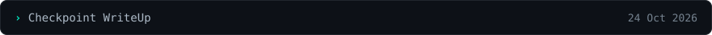</a>
<a href="https://hackpuntes.com/posts/php2shell-php-rce-cve-2026-109618-109619/">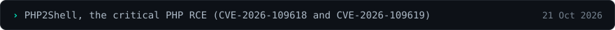</a>
<a href="https://hackpuntes.com/posts/hackthebox/machines/eloquia-writeup/">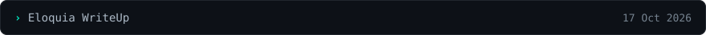</a>
<a href="https://hackpuntes.com/posts/hackthebox/machines/devhub-writeup/">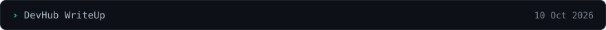</a>
<a href="https://hackpuntes.com/posts/hackthebox/machines/reactor-writeup/">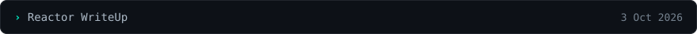</a>

<!-- POSTS:END -->

<a href="https://hackpuntes.com/posts/">📚 See all posts →</a>

<picture>
  <source media="(prefers-color-scheme: light)" srcset="assets/dist/title-summary-light.svg">
  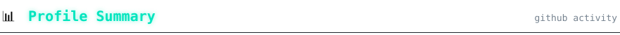
</picture>

<picture>
  <source media="(prefers-color-scheme: light)" srcset="assets/dist/title-activity-light.svg">
  
</picture>

<!-- FOOTER:START -->

<picture>
  <source media="(prefers-color-scheme: light)" srcset="assets/dist/footer-light.svg">
  
</picture>
<!-- FOOTER:END -->
